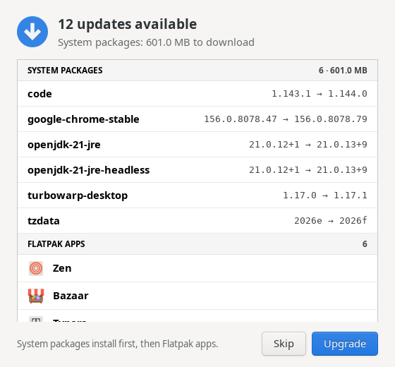
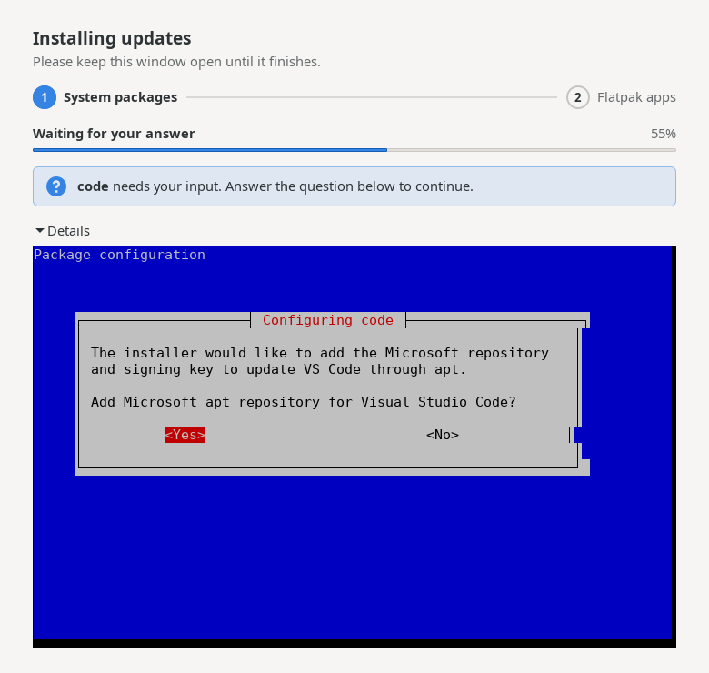
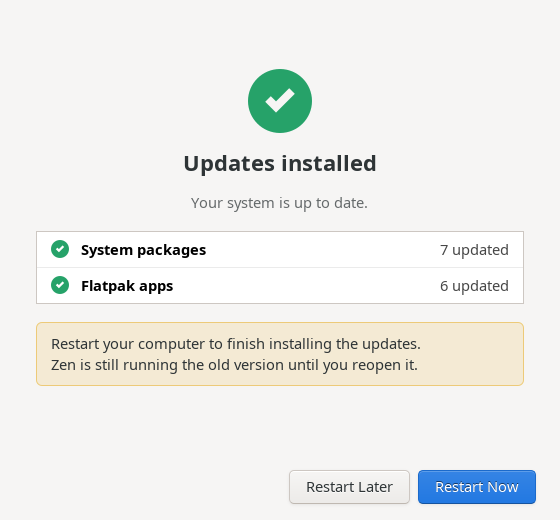
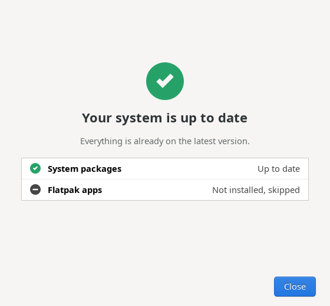

<h1 align="center">Shopno Update Helper</h1>

<p align="center">
  A simple updater for Debian, Ubuntu and their derivatives: system packages first, then Flatpak apps, all in one window.
</p>

<p align="center">
  <a href="https://github.com/fa-saikat/shopno-update-helper/releases/latest"></a>
  <a href="https://github.com/fa-saikat/shopno-update-helper/actions/workflows/build.yml"></a>
  
  <a href="COPYING"></a>
</p>

<p align="center">
  <a href="#features">Features</a> ·
  <a href="#limitations">Limitations</a> ·
  <a href="#installing">Install</a> ·
  <a href="#building">Build</a> ·
  <a href="#how-it-works">How it works</a> ·
  <a href="#credits">Credits</a>
</p>

> [!NOTE]
> Update Helper is young. It works, but expect rough edges, and please
> [report them](https://github.com/fa-saikat/shopno-update-helper/issues/new/choose).

## Why this exists

I built Update Helper for [ShopnoOS](https://github.com/fa-saikat/shopno-os),
our Debian-based distro. It replaces a small yad script that listed updates
and then opened a separate terminal window to install them. Most of our
users come from Windows, and a terminal full of scrolling text, or a blue
debconf dialog appearing out of nowhere, is not what they expect from
"update my computer".

The usual graphical updaters avoid the terminal by answering every question
a package asks with its default. That works until a package really needs an
answer: VS Code, for example, asks whether to add Microsoft's repository and
signing key. Update Helper keeps the installation in the window, shows a
progress bar, and opens a terminal inside the window only when a package
asks something.

It works on any Debian or Ubuntu based distribution.

## Features

<table>
  <tr>
    <td width="50%" valign="top">
      
      <p><b>See what will change.</b> System packages with their versions, packages that will be installed or removed, and Flatpak apps by name and icon. Runtimes fold into one row.</p>
    </td>
    <td width="50%" valign="top">
      
      <p><b>Questions are answered in the window.</b> When a package asks something, the built-in terminal opens and says which package is waiting.</p>
    </td>
  </tr>
  <tr>
    <td valign="top">
      
      <p><b>A clear result.</b> A summary for each source, a restart button when a restart is needed, and which Flatpak apps are still running their old version.</p>
    </td>
    <td valign="top">
      
      <p><b>Nothing to do?</b> It says so. Without Flatpak installed, that part is skipped and marked as such.</p>
    </td>
  </tr>
</table>

Also:

- **System packages first, then Flatpak apps**, shown as two steps.
- **One password prompt, only when needed.** Checking for updates and
  updating Flatpak apps need no password. Installing system packages asks
  once, through your desktop's usual authentication dialog.
- **Real progress**, read from apt's progress reports instead of guessed
  from the terminal output.
- **Repairs first.** An interrupted installation or broken dependencies are
  shown as a repair step and fixed before upgrading.
- **Honest errors.** No network, an unreachable package source, or a
  failed package each get their own message, with the full log under
  **Details**. If only Flatpak failed, you can retry just that.
- Follows your **GTK theme** (light or dark).

## Limitations

- **apt only.** It updates Debian and Ubuntu based systems, plus Flatpak.
  Snap packages are not updated.
- **Question detection is a guess.** Update Helper opens the terminal when
  apt reports a configuration file prompt, or when the terminal goes quiet
  showing a dialog or a question. A package that waits silently might not
  be noticed; **Details** shows the terminal at any time.
- **No version numbers for Flatpak apps.** Flatpak does not report the new
  version before downloading, so apps are listed by name only.
- **No background checks or notifications.** It checks when you open it.
- **No translations yet.**
- **Tested on Xfce under X11.** It should work on other desktops and on
  Wayland, but that has not been tested.

If one of these matters to you,
[open a feature request](https://github.com/fa-saikat/shopno-update-helper/issues/new/choose)
so I know what to do first.

## Installing

Download the package for your distribution from the
[latest release](https://github.com/fa-saikat/shopno-update-helper/releases/latest),
then install it:

| Distribution              | File                       | Install with                                         |
|---------------------------|----------------------------|------------------------------------------------------|
| Debian 13                 | `*.debian13_amd64.deb`     | `sudo apt install ./shopno-update-helper_*.deb`      |
| Debian 12                 | `*.debian12_amd64.deb`     | `sudo apt install ./shopno-update-helper_*.deb`      |
| Ubuntu 24.04, Mint 22     | `*.ubuntu24.04_amd64.deb`  | `sudo apt install ./shopno-update-helper_*.deb`      |
| Ubuntu 22.04, Mint 21     | `*.ubuntu22.04_amd64.deb`  | `sudo apt install ./shopno-update-helper_*.deb`      |

Each release also has a `SHA256SUMS` file to check the downloads with
`sha256sum -c --ignore-missing SHA256SUMS`.

Then open **Update Helper** from your applications menu.

## Building

Dependencies:

| Library     | Minimum version | Notes    |
|-------------|-----------------|----------|
| GLib        | 2.72            |          |
| GTK         | 3.24            |          |
| VTE         | 0.68            |          |
| libflatpak  | 1.12            | Optional |

You also need `meson`, `ninja`, a C compiler and `gettext`:

```sh
sudo apt install build-essential meson ninja-build gettext pkgconf \
  libglib2.0-dev libgtk-3-dev libvte-2.91-dev libflatpak-dev
```

Build, test and install:

```sh
meson setup build --prefix=/usr
meson compile -C build
meson test -C build
sudo meson install -C build
```

The prefix must be `/usr`: the polkit policy names the helpers by their
installed path, and pkexec refuses to run them from anywhere else. For the
same reason, the full flow only works once installed.

Options:

| Option           | Default | Description                                           |
|------------------|---------|-------------------------------------------------------|
| `-Dflatpak=`     | `auto`  | Update Flatpak apps (`enabled`, `disabled`, `auto`)   |
| `-Dtests=`       | `true`  | Build the unit tests                                  |
| `-Dpreview=`     | `false` | Build `shopno-update-preview` (see CONTRIBUTING.md)   |

To build the Debian package instead:

```sh
cp -r packaging/debian debian
sudo apt build-dep ./
dpkg-buildpackage -b -us -uc
```

## How it works

The window runs as you. Only two small helpers run as root, each started
through `pkexec` and each with its own polkit action:

| Helper                                      | Runs                                                          | Permission                       |
|---------------------------------------------|---------------------------------------------------------------|----------------------------------|
| `/usr/libexec/shopno-update-helper/apt-refresh` | `apt-get update`                                          | Allowed for the active local user |
| `/usr/libexec/shopno-update-helper/apt-upgrade` | `dpkg --configure -a`, `apt-get -f install`, `apt-get full-upgrade` | Administrator password, remembered for a few minutes |

The helpers take no commands, package names or options from the window, so
being allowed to run them only ever means "refresh" or "upgrade
everything". Refreshing without a password matches what PackageKit allows
by default. See [SECURITY.md](SECURITY.md) for the details.

The list of updates comes from simulating the same `apt-get full-upgrade`
the helper runs, so it matches what will happen, including held back
packages, phased updates, new dependencies and removals.

`apt-upgrade` runs in a [VTE](https://gitlab.gnome.org/GNOME/vte) terminal
inside the window, so debconf and dpkg can ask their questions there.
Progress comes from apt's `APT::Status-Fd` reports, passed back through a
FIFO in your runtime directory.

Flatpak apps and runtimes are updated with
[libflatpak](https://github.com/flatpak/flatpak), the library behind the
`flatpak` command. Flatpak's own polkit policy lets the active user update
installed apps without a password.

## Contributing

Bug reports, translations and patches are welcome. See
[CONTRIBUTING.md](CONTRIBUTING.md). Please report security problems
privately, as described in [SECURITY.md](SECURITY.md).

## Credits

Update Helper builds on:

- **[VTE](https://gitlab.gnome.org/GNOME/vte)** for the terminal inside the
  window, on **[GTK 3](https://gtk.org/)**.
- **[apt](https://salsa.debian.org/apt-team/apt)** and its machine-readable
  progress reports, **[polkit](https://github.com/polkit-org/polkit)** for
  permissions, and **[libflatpak](https://github.com/flatpak/flatpak)**.
- **[Synaptic](https://github.com/mvo5/synaptic)** and
  **[mintUpdate](https://github.com/linuxmint/mintupdate)**, which showed
  that a terminal inside the window is the reliable way to let packages ask
  their questions. Update Helper shares no code with either.

## License

Copyright © 2026 JaduPc and FA Saikat.

Update Helper was created by FA Saikat at JaduPc for ShopnoOS, and is
released under the [GNU General Public License v3.0 or later](COPYING).

ShopnoOS Linux is a trademark of JaduPc.
